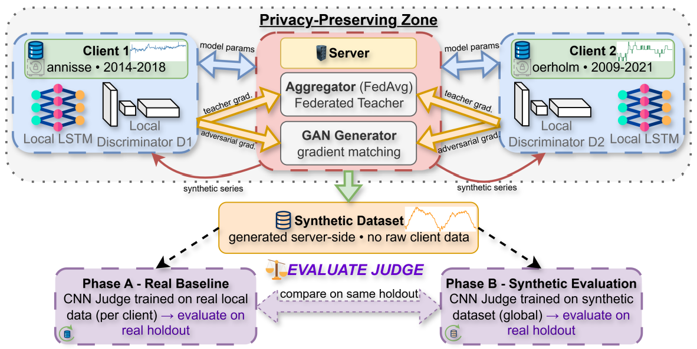

# EnrichTS+: Federated GAN-based Distillation for Privacy-Preserving Synthesis of Univariate Time Series

**EnrichTS+** is a federated GAN-based distillation framework that turns the predictive knowledge of a federated forecasting model into a compact **synthetic univariate time-series dataset**, without any client sharing raw measurements.

---

## Overview

Multiple clients with heterogeneous data collaborate without sharing raw records:

1. **Local baseline:** each client trains an LSTM on its own private data.
2. **Federated teacher:** clients train a shared LSTM teacher via FedAvg (or FedProx); only model parameters are exchanged.
3. **GAN distillation:** a server-side generator produces synthetic series, trained with gradient matching against the federated teacher, adversarial feedback from per-client discriminators (which never leave the clients), temporal smoothness regularization and global distribution alignment.
4. **Independent judge:** a CNN regressor trained only on the synthetic dataset is compared with the same architecture trained on real local data, both evaluated on each client's real hold-out set.

The task is univariate next-step forecasting: **past values plus timestamp-derived time features → next value**. The paper's case study is relative humidity (`%RH`) forecasting for cultural-heritage monitoring. The pipeline also runs on the RAIDO pilot data (see [Pilot data](#pilot-data-raido)).

### Architecture



---

## Repository Structure

```
src/
    gen_aggregator.py         # Server: FedAvg teacher, GAN distillation, synthetic CSV
    gen_worker.py             # Client: baseline, local FL training, teacher gradients, discriminator
    gen_fl_core.py            # Dataset setups (--dataset), loading, windowing, training, metrics
    gen_models.py             # Generator and Discriminator
    models.py                 # LSTMRegressor (baseline/teacher/student) and CNN1DRegressor (judge)
    comm_utils.py             # Socket messaging and state-dict serialization
    evaluate_judge.py         # Independent CNN-judge evaluation (no workers needed)
    evaluate_distilled.py     # Baseline vs federated teacher vs student comparison (uses workers)
    prepare_pilot_clients.py  # Builds the pilot client CSVs from the raw pilot export
    results/                  # Saved runs (results_final/ = paper run)
media/
    architecture.png          # Framework overview (Fig. 1 of the paper)
requirements.txt
```

Datasets are not tracked in git (see [Datasets](#datasets)).

---

## Installation

```bash
pip install -r requirements.txt
```

Requires Python 3.9+ and PyTorch ≥ 2.0. A CUDA GPU is optional (`--device cuda`).

---

## Datasets

The data format is selected with `--dataset {climate,pilot}`, which **must be passed to every script** (aggregator, each worker and the evaluation scripts). The default is `climate`.

| | `climate` (paper) | `pilot` (RAIDO pilot) |
|---|---|---|
| Columns | `DATE AND TIME`, `%RH` (extra columns ignored) | `f_time`, `n_value` |
| Separator | `;` | `,` |
| Timestamps | day-first, e.g. `25-03-2014 09:00` | ISO 8601 with UTC offset |
| Sampling | 1 hour | 1 minute |
| Generator output range | `[0, 100]` | `[0, 300]` |

### Climate data (paper)

Two real-world hourly indoor-climate datasets from cultural-heritage monitoring deployments, introduced in:

> C. Boesgaard, B. V. Hansen, U. B. Kejser, S. Mollerup, M. Ryhl-Svendsen, and N. Torp-Smith, "Prediction of the indoor climate in cultural heritage buildings through machine learning: first results from two field tests," *npj Heritage Science*, vol. 10, no. 1, p. 176, 2022.

The scripts expect the files at:

```
DBCDK-orholm-prediction-demo-4b15ae5/climate-data/annisse-indoor-climate-data_2014-2018.csv   # Client 1
DBCDK-orholm-prediction-demo-4b15ae5/climate-data/oerholm-indoor-climate-data_2009-2021.csv   # Client 2
```

| Client | Mean %RH | Std %RH | Train windows | Hold-out windows |
|---|---|---|---|---|
| C1 (annisse, 2014–2018) | 61.1 | 7.9 | 20,607 | 11,053 |
| C2 (oerholm, 2009–2021) | 50.7 | 4.2 | 20,607 | 11,053 |

Both clients are balanced to 36,842 hourly records (`--balanced_len 36842`).

### Pilot data (RAIDO)

The pipeline has also been run on data from a RAIDO pilot: 1-minute PV-panel power telemetry (W), with each panel acting as a federated client. The raw export is converted into one CSV per client (panels `4728` and `4730`, 43,200 rows = 30 days each):

```bash
python src/prepare_pilot_clients.py \
    --input_csv pilot_data/pilot_1_data/Datos_2025_2026/datos_2025.csv
# → pilot_data/pilot_1_data/data_for_demo/client_4728.csv
# → pilot_data/pilot_1_data/data_for_demo/client_4730.csv
```

The script removes duplicate timestamps, fills gaps on a 1-minute grid by linear interpolation, and keeps the most recent 43,200 points.

### Preprocessing (both setups)

- Cyclic time features from each timestamp: `hour_sin`, `hour_cos`, `month_sin`, `month_cos`
- Per-client normalization with training-set mean/std
- Model input per timestep: normalized value + 4 time features (`input_dim = 5`), look-back `seq_len = 24`
- Strictly chronological split: 70% train+val / 30% hold-out; train+val split 80% / 20%
- All clients trimmed to `--balanced_len` rows

---

## How to Run

Run all commands from the repository root. Output files are written to the current directory.

### 1. Start the aggregator

Settings used in the paper:

```bash
python src/gen_aggregator.py \
    --dataset climate \
    --host 0.0.0.0 --port 5100 \
    --num_clients 2 --balanced_len 36842 \
    --fl_rounds 5 --local_epochs 5 --lr 1e-3 \
    --distill_iters 5000 \
    --student_reinit_every 50 --student_steps 10 \
    --w_gradient 1.0 --w_adversarial 0.1 --w_smooth 0.05 --w_dist 1.0 --w_diversity 0.0 \
    --synthetic_out synthetic_timeseries.csv \
    --device cuda
```

### 2. Start one worker per client

Workers first train their local baseline, then connect to the aggregator (retrying for up to 150 s).

```bash
# Client 1
python src/gen_worker.py \
    --dataset climate \
    --data_path DBCDK-orholm-prediction-demo-4b15ae5/climate-data/annisse-indoor-climate-data_2014-2018.csv \
    --host 127.0.0.1 --port 5100 \
    --client_id 1 --balanced_len 36842 \
    --baseline_epochs 20 --baseline_pt baseline_client1.pt \
    --device cuda

# Client 2
python src/gen_worker.py \
    --dataset climate \
    --data_path DBCDK-orholm-prediction-demo-4b15ae5/climate-data/oerholm-indoor-climate-data_2009-2021.csv \
    --host 127.0.0.1 --port 5100 \
    --client_id 2 --balanced_len 36842 \
    --baseline_epochs 20 --baseline_pt baseline_client2.pt \
    --device cuda
```

`--baseline_pt` saves the baseline on the first run and reloads it on later runs, skipping baseline training.

### 3. Evaluate with the independent judge (no workers needed)

```bash
python src/evaluate_judge.py \
    --dataset climate \
    --client_csvs \
        DBCDK-orholm-prediction-demo-4b15ae5/climate-data/annisse-indoor-climate-data_2014-2018.csv \
        DBCDK-orholm-prediction-demo-4b15ae5/climate-data/oerholm-indoor-climate-data_2009-2021.csv \
    --synthetic_csv synthetic_timeseries.csv \
    --stats_json gen_stats.json \
    --balanced_len 36842 \
    --judge_epochs 30 --judge_lr 5e-4 \
    --device cuda
```

### Optional: baseline vs federated teacher vs student

`evaluate_distilled.py` trains an LSTM student on the synthetic CSV and compares it with the local baselines and the federated teacher on each client's hold-out set. The aggregator shuts its workers down when it finishes, so start fresh workers on a separate port:

```bash
python src/evaluate_distilled.py --dataset climate --port 5101 --num_clients 2 \
    --balanced_len 36842 --synthetic_csv synthetic_timeseries.csv --teacher_pt gen_teacher.pt

# then, in other terminals, the same worker commands as in step 2 with --port 5101
```

### Running on the pilot data

Use `--dataset pilot`, the pilot client CSVs and `--balanced_len 43200` in every command, for example:

```bash
python src/gen_worker.py --dataset pilot --client_id 1 --balanced_len 43200 \
    --data_path pilot_data/pilot_1_data/data_for_demo/client_4728.csv --port 5100
```

### Output files

| File | Content |
|---|---|
| `synthetic_timeseries.csv` | Synthetic series, in the same CSV format as the selected dataset |
| `gen_teacher.pt` | Federated teacher weights |
| `gen_generator.pt` | Generator weights |
| `gen_stats.json` | Aggregated normalization stats (`target_mean`, `target_std`) used by the evaluation scripts |
| `baseline_client{N}.pt` | Local baseline weights (if `--baseline_pt` is set) |

---

## Models

| Model | Architecture | Role |
|---|---|---|
| Baseline / Teacher / Student | `LSTMRegressor`: 2-layer LSTM (64 hidden) + 2-layer MLP head | Local baseline, federated teacher, student used for gradient matching |
| Generator | 1D CNN decoder: `z ∈ ℝ¹²⁸` → linear → (256, 8) → 5 transposed convs → 512 steps, sigmoid scaled to the value range | Server-side synthetic series generation |
| Discriminator | 3-layer 1D CNN, LeakyReLU, adaptive average pooling, sigmoid | Local to each client; only input gradients are sent |
| Judge | `CNN1DRegressor`: 3 conv blocks + adaptive pooling + 2-layer head | Independent evaluation only |

### Generator objective

```
L = w_gradient    × L_match     # student gradients on synthetic data ↔ aggregated teacher gradients
  + w_smooth      × L_smooth    # penalise large step-to-step jumps
  + w_dist        × L_dist      # match synthetic mean/std to aggregated real stats
  + w_diversity   × L_div       # keep at 0.0 (destabilises training)
  (+ w_adversarial × aggregated discriminator input gradients, injected via a backward hook)
```

The student is reinitialized and retrained for `--student_steps` steps every `--student_reinit_every` iterations. By default the synthetic dataset size is 35% of `balanced_len × num_clients` (override with `--target_rows`).

---

## Results (paper, climate data)

CNN judge on the real hold-out sets. Real: judge trained on each client's real local data. Synthetic: one judge trained on the EnrichTS+ synthetic dataset.

| Client | Trained on | RMSE | MAE | R² |
|---|---|---|---|---|
| C1 (annisse) | Real (local) | 0.9208 | 0.5494 | 0.9924 |
| | Synthetic | 1.1612 | 0.6948 | 0.9880 |
| C2 (oerholm) | Real (local) | 0.5620 | 0.4047 | 0.9620 |
| | Synthetic | **0.4766** | **0.3109** | **0.9727** |
| Weighted avg. | Real (local) | 0.7414 | 0.4771 | 0.9772 |
| | Synthetic | 0.8189 | 0.5029 | **0.9803** |
| **Gap (Syn − Real)** | | +0.077 | +0.026 | +0.003 |

The synthetic-trained judge comes within 10.5% of the real-data judge on RMSE, with slightly higher R². It outperforms the real-data judge on Client 2, whose distribution is close to the global mean, and trails on Client 1, whose mean and variance are higher. Logs and model files for this run are in [`src/results/results_final/`](src/results/results_final/).

---

## 📝 Paper & Citation

This repository is the official implementation of the paper *EnrichTS+: Pioneering Federated GAN-based Distillation for Privacy-Preserving Synthesis of Univariate Time Series*, presented at the [IEEE International Conference on Cyber Humanities (IEEE-CH)](https://www.ieee-ch.org/). It was developed by [MetaMind Innovations](https://metamind.gr/) within the [RAIDO Project](https://raido-project.eu/).

The DOI is not available yet; this entry will be updated once the proceedings are published.

```bibtex
@inproceedings{tsiamitas2026enrichts,
  title     = {EnrichTS+: Pioneering Federated GAN-based Distillation for Privacy-Preserving Synthesis of Univariate Time Series},
  author    = {Tsiamitas, Georgios and Tziolas, George and Ntampakis, Nikolaos and Misra, Sudip and Mallick, Prolay and Ghosh, Rajdeep and Ray, Kumarjit and Sargsyan, Gohar and Argyriou, Vasileios and Lagkas, Thomas and Markakis, Evangelos and Markakis, Albertos and Lapidaki, Kalliopi and Papadopoulos, Petros and Sarigiannidis, Panagiotis},
  booktitle = {2026 IEEE International Conference on Cyber Humanities (IEEE-CH)},
  year      = {2026},
  publisher = {IEEE},
  note      = {DOI forthcoming}
}
```

---

## 📄 License

MIT License - see [LICENSE](https://github.com/Metamind-Innovations/RAIDO_3_1_FDM_timeseries/blob/main/LICENSE) file.

## 🙏 Acknowledgments

**Made for the [RAIDO Project](https://raido-project.eu/), from [MetaMind Innovations](https://metamind.gr/)**

🇪🇺 RAIDO project has received funding from the European Union's Horizon Europe research and innovation programme under **Grant Agreement No. 101135800**.

*Disclaimer: Funded by the European Union. Views and opinions expressed are however those of the author(s) only and do not necessarily reflect those of the European Union or European Commission. Neither the European Union nor the European Commission can be held responsible for them.*
